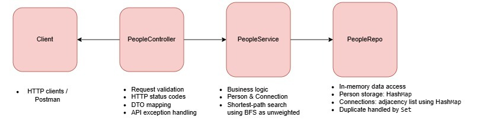

People & Connections API

Small REST API for storing people and their direct connections and finding how two people are connected.

## Architecture

## Architecture



## Tech

- Java 21
- Spring Boot
- Maven
- In-memory storage
- JUnit 5

No database is used.

## Run

Make sure Java 21 and Maven are installed.

```bash
mvn spring-boot:run
```

The server runs on:

```text
http://localhost:8080
```

## API

### Create a person

```http
POST /people
```

Request:

```json
{
  "name": "Asha"
}
```

Returns `201 Created` with the assigned ID.

### Create a connection

```http
POST /knows
```

Request:

```json
{
  "a": 1,
  "b": 2
}
```

Connections are mutual. Adding the same connection again is not an error.

### Get direct contacts

```http
GET /people/{id}/contacts
```

Returns the person's direct contacts.

### Find a path

```http
GET /path?from=1&to=5
```

The API looks for the shortest path with a maximum of 3 hops.

If no path exists within 3 hops:

```json
{
  "connected": false
}
```

## Tests

Tests cover the main API requirements, including:

- A path within 3 hops
- A path longer than 3 hops
- Same person as start and end
- Unicode names
- Invalid person names

Run them with:

```bash
mvn test
```

## Design

People are stored in memory using their assigned ID.

Connections are stored as an adjacency list using sets. This makes connections mutual and prevents duplicate connections.

The path search uses BFS because connections are unweighted and the shortest path is required.

## Improvements with more time

With more time I would add more API-level tests, improve error handling further, and replace the in-memory storage with a persistent database(Neo4j) if the application needed to retain data between restarts.

## AI tools

Used ChatGPT for debugging, readme, and test cases.
